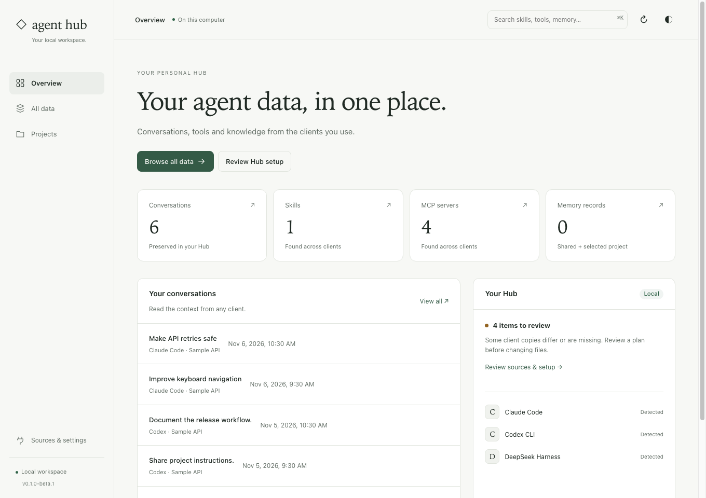

# Agent Hub website

The English/Russian landing page and documentation for [Agent Hub](https://github.com/get-agent-hub/agent-hub). Static HTML, CSS and JavaScript; no backend or runtime dependencies. Interactive examples use fictional data.

[Website](https://getahub.dev) · [English docs](https://getahub.dev/docs/) · [Русская документация](https://getahub.dev/ru/docs/)

## Run locally

Requires **Node.js 22.13+** and npm.

```sh
npm ci
npm run dev
```

Open http://127.0.0.1:3084. After source edits, run `npm run build` and reload. Run `npm run check` before submitting a change.

## Repository guide

| I want to…                                      | Read                                        |
| ----------------------------------------------- | ------------------------------------------- |
| Understand the source and update product claims | [Development guide](DEVELOPMENT.md)         |
| Translate the landing or documentation          | [Contributing](CONTRIBUTING.md)             |
| Configure Pages, DNS, HTTPS or roll back        | [Deployment guide](DEPLOYMENT.md)           |
| Read reviewable English documentation           | [Documentation snapshots](docs/overview.md) |
| Inspect validation and publication jobs         | [Workflows](.github/workflows/)             |

All rendered copy belongs in `locales/`. English and Russian build to `/` and `/ru/`, with documentation under each language's `/docs/`. Translation PRs preserve executable syntax and stable anchors.



[Archive and automatic updates](public/images/hub-archive.png) · [Continue in another client](public/images/hub-handoff.png) · [Saved conversation](public/images/hub-chat.png)

Screenshots show the real interface with fictional sample data. They are stored in `public/images/`; the landing uses the same images in both languages with localized captions and alternative text.

## Publish

GitHub Pages publishes `dist/` from **master** after validation and the history secret scan. The repository variable `PAGES_ENABLED=true` enables deployment. See the [deployment guide](DEPLOYMENT.md) for setup and recovery.

[Agent Hub source](https://github.com/get-agent-hub/agent-hub) · [MIT license](LICENSE)
